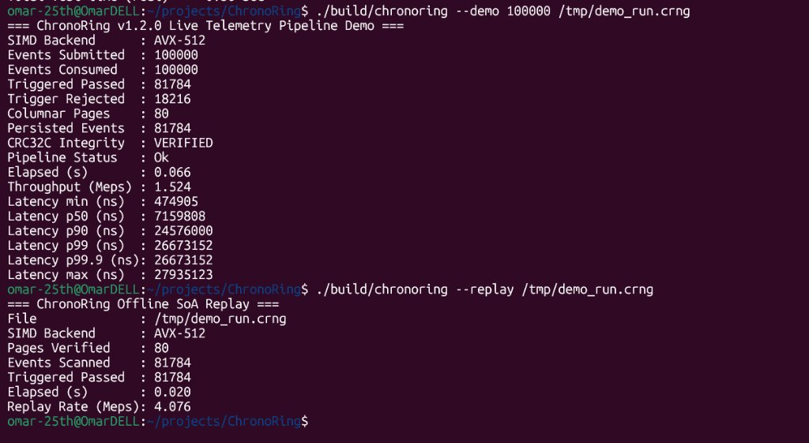
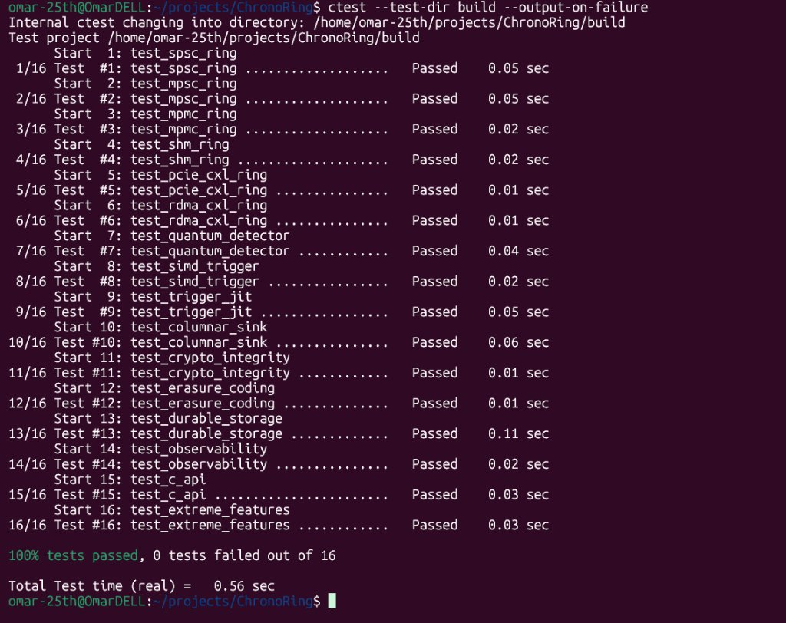

# ChronoRing

**Lock-Free Ring-Buffer Telemetry & SIMD Trigger Engine** (`C++20`, v1.2.0)

ChronoRing is a standalone, zero-allocation C++20 systems engineering library and pipeline designed for ultra-low-latency high-energy physics / detector telemetry ingestion, vectorized SIMD trigger filtering, and zero-copy memory-mapped columnar persistence with optional zero-allocation LZ4 page compression and hardware-accelerated CRC32C verification.

---

## Key Results (Isolated Microbenchmarks)

| Microbenchmark (`bench_chronoring`) | Value |
|--------|-------|
| SPSC ring throughput (single-thread) | **198.15 M items/s** (5.05 ns/op) |
| Cross-thread SPSC vs mutex queue | **~4.9× faster** |
| SIMD SoA trigger (AVX2) | **422.20 M events/s** (2.40× over scalar) |
| Hardware CRC32C | **4.97 GiB/s** (22.1× over software) |

> **Microbenchmark vs. end-to-end pipeline latency:** The `5.05 ns/op` figure measures isolated raw ring push/pop operations in `bench_chronoring`. End-to-end `TelemetryPipeline` runs (`./build/chronoring --demo`) include cross-thread batching, consumer scheduling/wakeups, SoA page staging, optional LZ4 compression, CRC32C checksumming, and disk/mmap I/O — typically exhibiting p50 event latencies in the hundreds of microseconds (e.g., ~840 µs on a typical laptop/WSL host).

Designed for high-rate detector telemetry: wait-free SPSC / fan-out rings, bounded Vyukov-style MPSC queuing, SIMD trigger filtering, and zero-copy columnar persistence.

ChronoRing targets the same constraints found in high-energy physics data acquisition: millions of events per second, strict latency bounds, zero-allocation hot paths, and the need for both high throughput and verifiable integrity. The design deliberately mirrors patterns used in modern DAQ and online systems (lock-free buffering, columnar layouts, SIMD filtering, memory-mapped persistence).

**Formal Methods Scope**: `formal/` contains small bounded TLA+ models (capacity 4, ~350 states) checking safety invariants (slot ownership, cursor bounds, FIFO ordering) and 5 Lean 4 modular-arithmetic lemmas without `sorry`. They do **not** prove full linearizability or C++20 weak-memory-model correctness, and they do not run in CI. Note also that strict wait-free progress holds on SPSC and `SpscFanOut` channels; `MpscRingBuffer` uses a bounded Vyukov per-slot CAS reservation protocol where a producer stalled mid-write blocks consumer progress on that specific slot until it resumes.

**Memory Cost Tradeoff (`MpscRingBuffer` vs. `SpscRingBuffer`)**: In `MpscRingBuffer`, each `alignas(64) Slot` pairs an `std::atomic<std::size_t> sequence` with `T data`. For 64-byte cache-aligned `EventFrame` payloads, the sequence word occupies its own 64-byte cache line ahead of `data` (`128 B/slot`, or **131,072 B** for 1,024 slots — **2×** the **65,536 B** slot storage of `SpscRingBuffer<EventFrame, 1024>`). This trades 2× memory for per-slot false-sharing isolation.

**Simulated / Software-Abstraction Backends**: The core ring buffers, SIMD triggers, LZ4 codec, CRC32C, memory-mapped `.crng` sink/reader, WAL store, shared-memory IPC, and crypto primitives are real C++20 implementations. By contrast, `pcie_cxl_ring.hpp`, `rdma_cxl_ring.hpp`, `hw_offload.hpp` (CUDA/HIP/DPDK/io_uring/FPGA), and the S3/MinIO/Ceph tier in `tiered_storage.hpp` are **local software simulations / abstraction layers** (no live kernel VFIO, `libibverbs`/RDMA, CUDA, DPDK, `io_uring`, or HTTP S3 client code).

---

## Architecture

```text
  Detector / Producer Thread(s)
        │
        ▼  (Wait-free SPSC / Fan-Out / Bounded Vyukov MPSC / POSIX & Win32 SHM IPC)
  ┌──────────────────────────────────────────────────────────┐
  │  64B Cache-Line Aligned EventFrame Ring Buffer           │
  │  - Shadow index caching, span batching, reserve/commit   │
  │  - Adaptive batching & explicit back-pressure signals    │
  └──────────────────────────────────────────────────────────┘
        │  (Adaptive batch pop on NUMA/core-pinned consumer thread)
        ▼
  ┌──────────────────────────────────────────────────────────┐
  │  SIMD Trigger Engine (AVX2 / SSE4.2 / NEON / Scalar)     │
  │  - SoA-first or AoS filtering + reject-reason bitmask    │
  │  - Custom predicate hook & JSON config serialization     │
  └──────────────────────────────────────────────────────────┘
        │
        ├──────────────────────────────┐
        ▼                              ▼
  ┌──────────────────────────┐   ┌───────────────────────────┐
  │ Zero-Copy ColumnarSink   │   │ Lock-Free HDR Latency     │
  │ - In-memory staging page │   │ Histogram (p50/p99/p99.9) │
  │ - Optional LZ4 page comp │   │ + Reject-reason counters  │
  │ - Durable dual-write     │   │ + Prometheus export       │
  │ - Hardware CRC32C + mmap │   └───────────────────────────┘
  └──────────────────────────┘
```

### Key Modules

| Header / Module | Description |
|---|---|
| `include/chronoring/chronoring.hpp` | Umbrella header including all ChronoRing C++20 APIs and C ABI declarations. |
| `include/chronoring/status.hpp` | `RingStatus`, `Expected<T, E>`, `version()`, and lock-free structured `LogCallback` hooks. |
| `include/chronoring/event_frame.hpp` | 64-byte `EventFrame`, `ColumnarPageHeader`, `ColumnProjectionMask`, and 1024-event `ColumnarPage` (`57,408` bytes). |
| `include/chronoring/spsc_ring.hpp` | Wait-free `SpscRingBuffer` (shadow caching, `std::span` batching, RAII `reserve_push`/`reserve_pop` & `try_reserve_push`/`try_peek`) + wait-free `SpscFanOut`. |
| `include/chronoring/mpsc_ring.hpp` | Bounded Vyukov-style `MpscRingBuffer` (lock-free CAS slot reservation, exception-safe pre-CAS construction, `seq_cst` wakeups; `128 B/slot` = 2× slot memory vs. `SpscRingBuffer` for 64 B `EventFrame`s). |
| `include/chronoring/mpmc_ring.hpp` | Lock-free `MpmcRingBuffer` and arbitrary M:N `RingTopologyRouter` (`Broadcast`, `RoundRobin`, `PredicateFiltered`). |
| `include/chronoring/shm_ring.hpp` | Cross-process shared-memory ring (`shm_open`/`mmap` on POSIX, `CreateFileMapping` on Win32) + `ShmScopeGuard`. |
| `include/chronoring/pcie_cxl_ring.hpp` | *Simulated* PCIe BAR / CXL.mem DMA ring abstraction (`PcieCxlRing`, `MockFpgaDmaProducer`; local memory simulation, no kernel VFIO/PCIe driver). |
| `include/chronoring/rdma_cxl_ring.hpp` | *Simulated* distributed fabric transport (`FabricRingEndpoint`; local loopback/software simulation, no live `libibverbs`/RoCEv2/InfiniBand RDMA stack). |
| `include/chronoring/quantum_detector.hpp` | Cryogenic & quantum sensor ingestion adapters (`SNSPD`, `TES`, `MKID`, `SQUID`, `IonTrapQubit`) and trigger presets. |
| `include/chronoring/simd_trigger.hpp` | AVX-512, AVX2, SSE4.2, SVE2, NEON, RVV, WASM-SIMD128, and scalar kernels + diagnostics & JSON serialization. |
| `include/chronoring/trigger_jit.hpp` | Custom trigger DSL compiler & 64-lane SIMD bytecode / native JIT evaluator (`compile_trigger_dsl`). |
| `include/chronoring/hw_offload.hpp` | *Simulated* hardware trigger offload router (`IoUring`, `Dpdk`, `CudaHipGpu`, `FpgaOpenCl`) dispatching to local simulation / CPU SIMD fallback (no live CUDA, DPDK, or `io_uring` driver code). |
| `include/chronoring/soa_pipeline.hpp` | Pure-SoA dataflow hot path (`SoaDataflowPipeline`, `SoaBatchBuilder`, `compact_soa_page`) with zero AoS conversion. |
| `include/chronoring/columnar_sink.hpp` | In-memory staged `ColumnarSink` (projection + optional LZ4 compression) & `ColumnarReader` (time/sequence seeking, CRC32C, offline replay). |
| `include/chronoring/crypto_integrity.hpp` | FIPS 180-4 SHA-256, RFC 2104 HMAC-SHA256, RFC 5869 HKDF-SHA256, `PageMerkleTree`, and 256-bit single-use RFC 8391-style WOTS+ signatures. |
| `include/chronoring/erasure_coding.hpp` | Systematic GF(2^8) Cauchy Reed-Solomon encoder/reconstructor with per-shard CRC32C. |
| `include/chronoring/durable_store.hpp` | ACID group-commit WAL (`DurableColumnarStore`), synchronous quorum replication, and time-travel PITR. |
| `include/chronoring/tiered_storage.hpp` | *Simulated* multi-tier NVMe → SSD → S3/MinIO/Ceph tiering (`TieredStorageManager`) & `GeoReplicatedBackup` (local filesystem / simulated object-store abstraction, no live S3 HTTP client). |
| `include/chronoring/lz4_codec.hpp` | Zero-allocation LZ4-format block encoder/decoder using a fixed 16 KiB stack hash table. |
| `include/chronoring/numa.hpp` | Portable CPU topology queries and core-pinning / NUMA policy helpers. |
| `include/chronoring/latency_histogram.hpp` | Lock-free logarithmic HDR histogram (`< 0.8%` bucket width, `0 ns` to `> 270 s`). |
| `include/chronoring/pipeline.hpp` | End-to-end `TelemetryPipeline`, adaptive batching, back-pressure signals, durable dual-write, JSON config, and Prometheus exporter. |
| `include/chronoring/observability.hpp` | Line-rate wait-free `LineRateTracer`, `ScopedLineRateSpan`, OTLP/JSON trace & metric exporters, and Prometheus metrics. |
| `include/chronoring/control_plane.hpp` | Zero-drop double-buffered `LiveConfigStore` reload, Welford `StreamingAnomalyDetector`, and `PipelineAutoTuner`. |
| `include/chronoring/c_api.h` | Pure C99/C11 ABI (`chronoring_spsc_*`, `chronoring_sink_*`, `chronoring_reader_*`, `chronoring_shm_*`, `chronoring_pipeline_*`). |
| `python/chronoring/__init__.py` | Thin zero-dependency `ctypes` Python bindings built atop `libchronoring_core`. |
| `python/chronoring/live_stream.py` | Incremental live `.crng` columnar stream tailer (`LiveCrngStream`) with PyArrow/Polars/Jupyter adapters. |
| `python/chronoring/dashboard.py` | Zero-dependency HTTP web dashboard & control plane (`/api/metrics`, `/metrics`, `/api/otlp`, `POST /api/config`). |
| `include/chronoring/event_crypto.hpp` | Per-detector RFC 8439 ChaCha20-Poly1305 AEAD (`DetectorKeyVault` with HKDF-SHA256 subkey separation, stateful counter-owning `DetectorEncryptor`, and AAD-bound HMAC-SHA256 flag trapdoors). |
| `include/chronoring/deterministic_replay.hpp` | Bit-identical multi-file offline replay (`DeterministicReplayEngine`) with SHA-256 `PageMerkleTree` transcript digest. |
| `include/chronoring/raft_cluster.hpp` | Embedded Raft consensus (`RaftRingCluster`) forming a single logical distributed ring with quorum replication & failover. |
| `include/chronoring/scientific_interop.hpp` | Zero-copy Apache Arrow C Data Interface (`export_columnar_page_to_arrow`) and HDF5 / Parquet / CERN ROOT schema export. |
| `include/chronoring/c89_compat.h` | Pure ISO C89 fallback header (`cr89_u64_t`) compliant with `-std=c89 -pedantic -Werror`. |
| `bindings/` | Multi-language FFI bindings for Rust, Go, Julia, C#, Java, LabVIEW, and MATLAB. |
| `deploy/` | Kubernetes Operator & CRD, Helm DaemonSet (HugePages + CPU isolation), and HashiCorp Nomad job spec. |
| `packaging/` | Multi-ecosystem recipes (`vcpkg`, `Conan`, `conda-forge`, `PyPI`, `npm`, `Homebrew`, `Spack`, `Nix`, `Guix`, `Fedora`). |
| `tools/chronoring_selfhost.py` | Self-hosting specializing compiler generating constant-folded C++20 detector engines from `.ddl.json` specs. |

---

## On-Disk `.crng` Columnar Format (v1, Little-Endian)

Each `.crng` file is an array of fixed `57,408`-byte, 64-byte aligned `ColumnarPage` frames:

| Byte Offset | Size | Field / Layout |
|---|---|---|
| `0..63` | `64 B` | `ColumnarPageHeader` (`magic = 0x43524E47` `"CRNG"`, `version = 1`, `flags = ColumnProjectionMask`, `event_count`, `capacity = 1024`, `min_timestamp_ns`, `max_timestamp_ns`, `first_sequence_id`, `last_sequence_id`, `data_crc32c`, `header_crc32c`) |
| `64..16447` | `16,384 B` | `timestamp_ns[1024]`, `sequence_id[1024]` (`uint64_t`) |
| `16448..53311` | `36,864 B` | `detector_id`, `channel_id`, `energy_mev`, `timing_ps`, `pos_x_mm`, `pos_y_mm`, `pos_z_mm`, `pileup_score`, `quality_flags` (9 x 4 KB) |
| `53312..57407` | `4,096 B` | `multiplicity[1024]`, `trigger_mask[1024]` (`uint16_t`) |

### Optional Zero-Allocation LZ4 Compression

- **How to enable**: Pass `enable_compression = true` to `ColumnarSink::open(...)`, set `PipelineConfig::enable_compression = true`, or pass `enable_compression = 1` in the C/Python APIs.
- **On-disk flag & framing**: Sets `kPageFlagLz4` (`1 << 8`) in `ColumnarPageHeader::flags` and stores the compressed payload length in `header.compressed_bytes` (bytes `56..59`). `data_crc32c` is computed over the compressed payload, and `ColumnarSink::close()` truncates the file to the exact compressed byte count.
- **Performance impact**: Uses a fixed 16 KiB stack hash table and a pre-allocated scratch buffer sized once in `open()` — **zero heap allocations** on the hot path. Structured detector telemetry typically compresses by **3x–10x** on disk while keeping `ColumnarReader::read_page()` and `replay_filtered()` transparent.

See [docs/DESIGN.md](docs/DESIGN.md) for detailed architecture notes.

---

## Measured Performance (`bench_chronoring`, GCC 13 `-O3`, 8-core x86_64)

These numbers are **isolated component microbenchmarks** from `bench_chronoring`:

| Microbenchmark | Measured Throughput / Latency | Notes |
|---|---|---|
| `SpscRingBuffer` single-thread push/pop | **198.15 M items/s** (`5.05 ns/op`, `11.81 GiB/s`) | Raw ring op, shadow index caching |
| `SpscRingBuffer` cross-thread vs `std::mutex` + `std::queue` | **14.87 M items/s** vs `6.39 M items/s` | **~4.9x faster** wall-clock (`0.74 ms` vs `3.66 ms`) |
| SIMD SoA Trigger (`ColumnarPage`, AVX2 vs Scalar) | **422.20 M items/s** vs `175.65 M items/s` | **2.40x speedup**, bit-exact |
| Hardware CRC32C (`_mm_crc32_u64`) vs Software Table | **4.97 GiB/s** vs `229.41 MiB/s` | **22.1x speedup** on 57.4 KB page |

For end-to-end pipeline runs (`./build/chronoring --demo`), latency includes producer-to-consumer batching, thread scheduling/wakeups, SoA staging, compression, CRC32C, and disk/mmap I/O (typically hundreds of microseconds p50, e.g., ~840 µs on a laptop/WSL host), rather than the `5.05 ns` raw ring operation.

For extended concurrency soak testing beyond the default CTest counts, set `CHRONORING_STRESS_SCALE` (e.g., `CHRONORING_STRESS_SCALE=10 ctest --test-dir build -R "spsc|mpsc" --output-on-failure`).

---

## Building, Installing & Testing

### Release Build + Install

```bash
cmake -S . -B build -DCMAKE_BUILD_TYPE=Release
cmake --build build --parallel
ctest --test-dir build --output-on-failure
cmake --install build --prefix /usr/local
```

Optional CMake flags:
- `-DCHRONORING_BUILD_SHARED=ON` — Build `libchronoring_core.so` / `chronoring_core.dll` (required for Python bindings).
- `-DCHRONORING_BUILD_FUZZERS=ON` — Build `fuzz_rings` and `fuzz_columnar` libFuzzer targets (Clang).
- `-DCHRONORING_ENABLE_ASAN_UBSAN=ON` — Build with AddressSanitizer + UndefinedBehaviorSanitizer.
- `-DCHRONORING_ENABLE_TSAN=ON` — Build with ThreadSanitizer.

Packaging:
- **CPack**: `cpack --config build/CPackConfig.cmake -G "DEB;RPM;TGZ"`
- **vcpkg**: Manifest and port files are provided in `packaging/vcpkg/`.

### Integration Example

```cpp
#include <chronoring/chronoring.hpp>

int main() {
    chronoring::PipelineConfig cfg;
    cfg.output_path = "run_001.crng";
    cfg.use_soa_staging = true;

    chronoring::TelemetryPipeline pipeline(cfg);
    if (!pipeline.start()) return 1;

    chronoring::EventFrame ev{};
    ev.energy_mev = 42.5f;
    ev.quality_flags = chronoring::kFlagValid;
    ev.multiplicity = 2;
    pipeline.submit_wait(ev);

    pipeline.stop();
    return pipeline.last_status() == chronoring::RingStatus::Ok ? 0 : 1;
}
```

### Python Quickstart

Build with `-DCHRONORING_BUILD_SHARED=ON`, then run with `PYTHONPATH=python`:

```python
import chronoring

cfg = chronoring.default_pipeline_config()
cfg.output_path = b"run_001.crng"
cfg.enable_compression = 1
cfg.trigger.min_energy_mev = 10.0

with chronoring.TelemetryPipeline(cfg) as pipe:
    ev = chronoring.EventFrame(energy_mev=42.5, quality_flags=0x1, multiplicity=2)
    pipe.submit_wait(ev)
    pipe.stop()
    st = pipe.stats()
    print(f"Passed={st.passed_events} Pages={st.pages_written}")

with chronoring.ColumnarReader("run_001.crng") as reader:
    assert reader.verify_all()
```

See [python/examples/quickstart.py](python/examples/quickstart.py) for a complete runnable script.

---

## CLI Usage

```bash
# Live telemetry pipeline demo (persists .crng and verifies CRC32C)
./build/chronoring --demo 100000 run.crng

# Offline SoA SIMD replay of a persisted .crng file
./build/chronoring --replay run.crng

# Export Prometheus/OpenTelemetry metrics exposition
./build/chronoring --prometheus 50000

# JSON benchmark & tail-latency report
./build/chronoring --json-report report.json

# Cross-process shared-memory IPC demo
./build/chronoring --shm-producer detector_feed 100000
./build/chronoring --shm-consumer detector_feed 100000

# Generate a complete C++20 DAQ pipeline from a Detector Description Language (.ddl.json) spec
python3 tools/chronoring_ddl.py examples/detectors/cryo_snspd_array.ddl.json --out-dir build/gen_snspd
python3 tools/chronoring_ddl.py examples/detectors/collider_calorimeter.ddl.json --out-dir build/gen_calorimeter

# Self-host compile a specialized constant-folded C++20 detector engine
python3 tools/chronoring_selfhost.py examples/detectors/cryo_snspd_array.ddl.json --out-dir build/selfhost_snspd

# Launch real-time Web Dashboard & Jupyter/Polars live columnar monitor
PYTHONPATH=python python3 -m chronoring.dashboard --host 127.0.0.1 --port 8080 --crng run.crng
```

### Live CLI & Test Run Screenshots

**Live Pipeline Demo & Offline SoA Replay (`--demo` / `--replay`):**



**Full Unit & Integration Test Suite (`ctest --test-dir build --output-on-failure`):**



---

## Formal Models & Arithmetic Lemmas

Small formal models and arithmetic lemmas live in `formal/` (run locally; not executed in CI):
- **TLA+ Models**: `formal/tla/SpscRing.tla` and `formal/tla/MpscRing.tla` run TLC at bounded capacity 4 (~350 states) checking shadow-cursor monotonicity, slot ownership, sequence safety, and FIFO ordering under sequential interleaving.
- **Lean 4 Lemmas**: `formal/lean/ChronoRingProofs.lean` contains 5 zero-`sorry` modular-arithmetic lemmas for ring index disjointness and active ticket exclusivity (see [formal/README.md](formal/README.md)). These do not prove full linearizability or C++20 weak-memory-model reorderings.

---

## License

MIT License — see [LICENSE](LICENSE).
